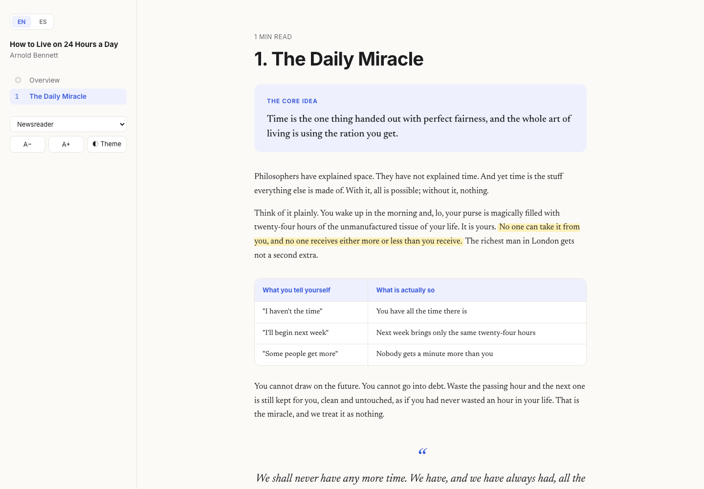
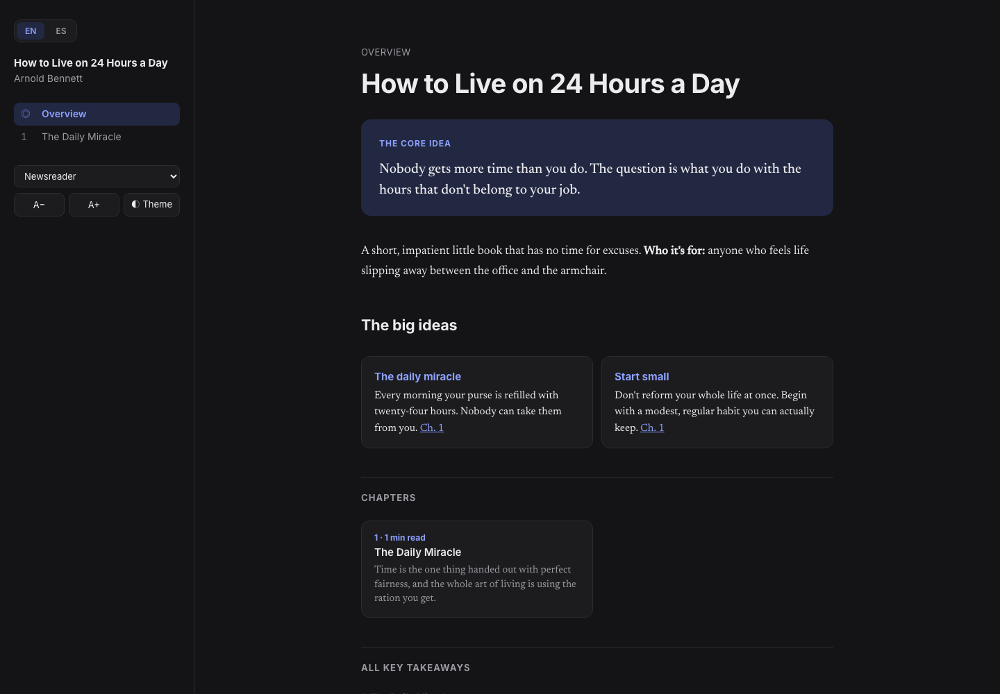

# headway-this

A Claude Code skill that turns a whole book (EPUB, PDF or TXT) into Headway/Blinkist-style summaries. Each chapter gets its own summary, written in the author's voice instead of the flat "the author argues…" tone of most AI summaries. Every chapter ends with one-line key takeaways and concrete things to do. The result is a single, minimal HTML book built for visual learners.



## What you get

- **Chapter-by-chapter summaries** of about 800–1200 words each. They keep the author's order of argument, their stories, names and numbers, and their attitude.
- **Written as the author**: first person if they write in first person, and the same rhythm, humor and terms of art. A voice profile is built from the book before any chapter is written, so the tone stays consistent.
- **Key takeaways**: 5–8 one-liners per chapter, each one a claim that makes sense on its own.
- **Put it into practice**: 3–5 concrete actions per chapter, shown as a checklist that remembers what you ticked.
- **Visual blocks**: core-idea banner, concept cards, step-by-step flows, side-by-side comparisons, big stats, pull quotes and highlights.
- **One self-contained `book.html`**: sidebar navigation, reading progress bar, light/dark mode, and an overview page with chapter cards and every takeaway in one place.
- **Reading comfort**: switch between Newsreader, Literata, Source Serif, Merriweather, Atkinson Hyperlegible, Lexend, OpenDyslexic and Inter, and resize the text. The choice is saved across books.
- **Bilingual books**: summarize in one language or two, with an EN | ES switch that keeps your place.
- **Plain Spanish**: neutral and simple by default, with optional regional flavor (Dominican, Mexican…). Spanglish is used where a literal translation would kill the meaning ("la puede *turn off*", not "apagarla").



See [`docs/example/`](docs/example/) for a small bilingual sample built from Arnold Bennett's public-domain *How to Live on 24 Hours a Day*. Download `book.html` and open it in a browser.

## Install

```bash
git clone https://github.com/morenojulio/headway-this ~/.claude/skills/headway-this
```

Requirements:
- [Claude Code](https://claude.com/claude-code)
- Python 3.8+ (standard library only)
- `pandoc` for EPUB and `pdftotext` (poppler) for PDF. On macOS: `brew install pandoc poppler`

## Use

In Claude Code:

```
/headway-this ~/Books/some-book.epub
```

You can also just ask: "resúmeme este libro", "summarize this book chapter by chapter", or "headway this". The skill asks which language(s) you want, and for Spanish, whether you want a regional flavor. Then it:

1. Splits the book into chapters (`scripts/extract_chapters.py`).
2. Reads the introduction and sample passages and writes a voice profile (`_voice.md`).
3. Reads each chapter in full and writes its summary, in parallel batches for long books.
4. Writes the overview.
5. Renders everything into `book.html` (`scripts/build_book.py`).
6. Runs a quality pass: no narrator phrases, no invented facts, length and structure checks.

Output goes to `./book-summaries/<book>/`:

```
book-summaries/<book>/
├── book.html            ← open this
├── 00-overview.md
├── 01-<chapter>.md      ← one Markdown source per chapter
├── 01-<chapter>.es.md   ← second language, if requested
├── _voice.md
├── _book.json
└── _source/             ← extracted chapter text
```

The Markdown files are the source. Edit any of them and rebuild with:

```bash
python3 ~/.claude/skills/headway-this/scripts/build_book.py ./book-summaries/<book>
```

## Files

| Path | What it is |
|---|---|
| `SKILL.md` | The workflow Claude follows |
| `references/anti-ai-voice.md` | Patterns that make summaries read as AI, and what to do instead |
| `references/spanish-plain.md` | Plain-Spanish guide, Spanglish rules and regional flavor |
| `scripts/extract_chapters.py` | Splits EPUB/PDF/TXT into chapters; cleans pandoc and Calibre markup |
| `scripts/build_book.py` | Renders the Markdown summaries into one HTML book |

## A note on books

Use it on books you own, for your personal study. Summaries quote only short lines and paraphrase the rest. Generated summaries of copyrighted books are for you; don't redistribute them.

## License

MIT
